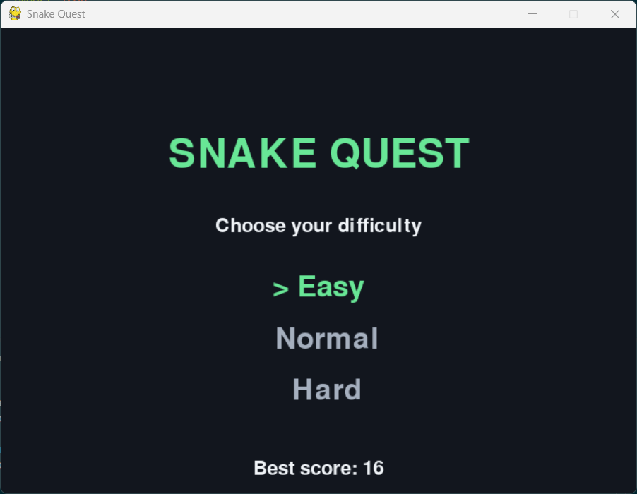
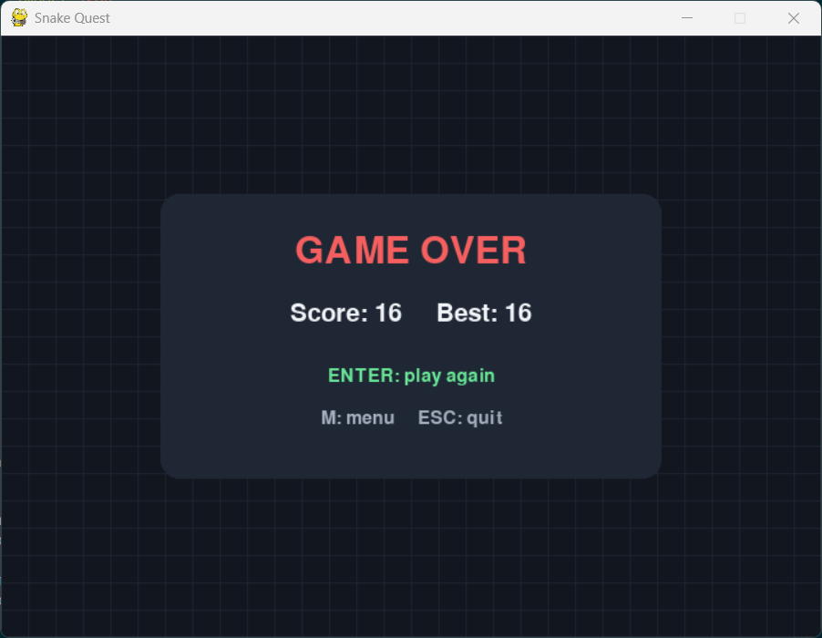

# 🐍 Snake Quest

A classic grid-based Snake game built with **Python** and **Pygame**. Choose a difficulty, collect food to grow, avoid walls and your own tail, and try to beat your best score.

## Screenshots

### Difficulty selection


### Game over and score


## Features

- Three difficulty levels: **Easy**, **Normal**, and **Hard**
- Arrow keys or WASD for movement
- Pause and resume gameplay
- Wall and self-collision detection
- Food spawns only in empty grid cells
- Score tracking and locally saved personal best
- Restart or return to menu after game over
- Game logic separated from Pygame rendering for unit testing

## Requirements

- Python 3.9 or newer
- Pygame 2.x

## Installation and running

1. Download or clone this repository and open a terminal in the project folder.
2. (Recommended) Create a virtual environment:

   ```bash
   python -m venv .venv
   ```

3. Activate it:

   **Windows (PowerShell):**
   ```powershell
   .venv\Scripts\Activate.ps1
   ```

   **macOS / Linux:**
   ```bash
   source .venv/bin/activate
   ```

4. Install and play:

   ```bash
   python -m pip install -r requirements.txt
   python main.py
   ```

On Windows, `py` can be used instead of `python` if necessary.

## Controls

| Screen | Key | Action |
| --- | --- | --- |
| Menu | Up / Down or W / S | Choose difficulty |
| Menu | Enter / Space | Start |
| Menu | Esc | Quit |
| Playing | Arrow keys / WASD | Move |
| Playing | P | Pause |
| Playing | Esc | Return to menu |
| Paused | P | Resume |
| Paused | Esc | Return to menu |
| Game over | Enter | Play again |
| Game over | M | Return to menu |
| Game over | Esc | Quit |

## Tests

The core rules can be tested without opening a game window:

```bash
python -m unittest discover -s tests -v
```

## Project structure

```text
snake-quest/
├── main.py                  # Pygame interface and game loop
├── game_logic.py            # Movement, collisions, food, and scores
├── requirements.txt         # Python dependencies
├── README.md                # Project documentation
├── .gitignore               # Local files excluded from Git
├── screenshots/
│   ├── menu.png
│   └── game-over.png
└── tests/
    └── test_game_logic.py  # Automated logic tests
```

## How it works

The board contains **30 × 22** cells. The snake starts with three segments and moves one cell per update. Eating food increases the score and length; hitting a wall or the snake's body ends the round. Difficulty changes the update speed (7, 11, or 16 frames per second). The best score is saved to `high_score.json` on your own computer; this generated file is intentionally not committed to GitHub.

## Future improvements

- Sound effects and animations
- A victory screen for filling the board
- Customizable themes and board sizes
